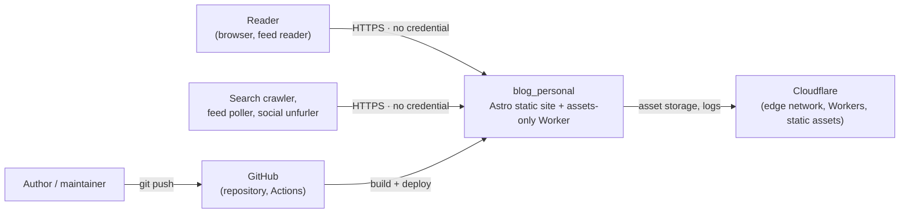

# Context and Scope

## 1. System context diagram

`blog_personal` is a bilingual personal blog and digital garden. Everything a reader sees is rendered at
build time; Cloudflare serves the resulting files through a thin Worker that adds security headers.

## 2. Stakeholders and concerns

| Stakeholder           | Concern                                                                  | How these docs address it                                                                                                |
| --------------------- | ------------------------------------------------------------------------ | ------------------------------------------------------------------------------------------------------------------------ |
| Author and maintainer | Publish a post in Vietnamese or English without touching layout code.    | [`04-runtime-flows.md`](04-runtime-flows.md); `../features/content-pipeline.md`                                          |
| Author and maintainer | Know what is live and what to do next.                                   | [`../status.md`](../status.md), [`../operations/README.md`](../operations/README.md)                                     |
| Reader                | Read fast on a phone, switch language, subscribe, find a post by search. | [`07-quality-requirements.md`](07-quality-requirements.md), [`08-crosscutting-concepts.md`](08-crosscutting-concepts.md) |
| Contributor           | Change one workspace without rebuilding everything.                      | [`02-container-view.md`](02-container-view.md), [`../development/README.md`](../development/README.md)                   |
| Operator              | Deploy safely, read logs, and roll back.                                 | [`05-deployment-view.md`](05-deployment-view.md), [`../operations/ci-cd-pipeline.md`](../operations/ci-cd-pipeline.md)   |

## 3. External partners and interfaces

| Partner                | Inputs to the system                             | Outputs from the system                        | Protocol                |
| ---------------------- | ------------------------------------------------ | ---------------------------------------------- | ----------------------- |
| Cloudflare edge        | Reader HTTP requests, TLS termination, CDN cache | HTML, feeds, sitemap, assets, security headers | HTTPS                   |
| Cloudflare asset store | Stored build output                              | The files the Worker fetches                   | Platform binding        |
| GitHub                 | Commits, pull requests, environment approvals    | Build output, deployed Worker version          | Git over HTTPS, Actions |
| Reader's feed apps     | Feed subscription requests                       | RSS 2.0, JSON Feed 1.1, per-tag RSS            | HTTPS                   |

There is no identity provider, no payment provider, no database, no email service, and no third-party
analytics script in the runtime path.

**Interface ownership.** The public surface is the built HTML and the feed formats, produced by
`apps/web` and described in [`../features/content-pipeline.md`](../features/content-pipeline.md).

## 4. Scope

### In scope

- The public site: home, post list, post detail, tags, about, search, 404, in `vi` and `en`.
- Content authoring: MDX files in `packages/content/posts/{vi,en}` with frontmatter validated at build time.
- Feeds and discovery: per-locale RSS and JSON Feed, per-tag RSS, sitemap, canonical and `hreflang` metadata.
- Build, deploy, and rollback of static assets.

### Out of scope

- Comments, newsletters, and outbound email.
- User accounts, authentication, and authorization.
- Server-side rendering, personalization, and per-request HTML generation.
- Persistent storage of any kind.
- A CMS; content is Markdown/MDX in the repository.

## 5. References

- Related chapters: [`02-container-view.md`](02-container-view.md), [`05-deployment-view.md`](05-deployment-view.md), [`09-glossary.md`](09-glossary.md).
- Decisions: [`../adr/0012-static-site-with-assets-only-worker.md`](../adr/0012-static-site-with-assets-only-worker.md), [`../adr/0011-remove-contact-feature.md`](../adr/0011-remove-contact-feature.md).
- Current state: [`../status.md`](../status.md).
