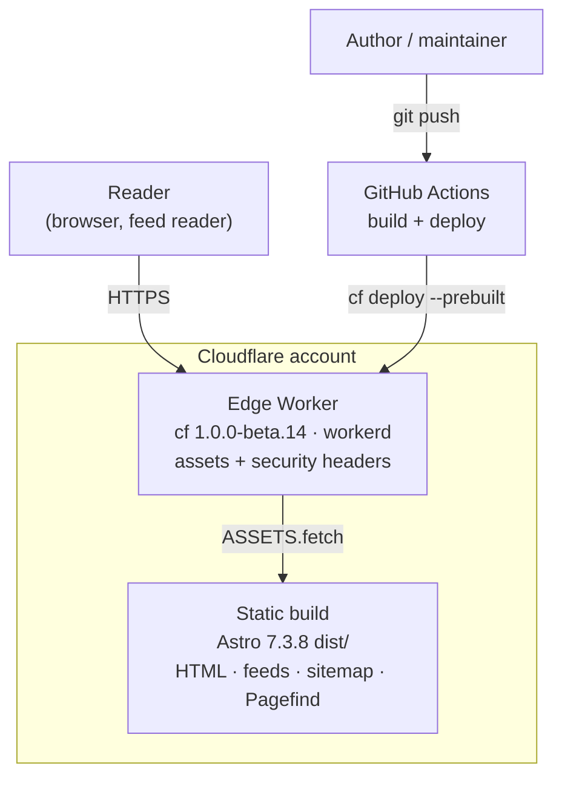

# Container View

## 1. Container diagram

C4 Level 2. The system has two deployable elements and no shared store: the static build and the Worker
that serves it. Cloudflare's asset store is platform infrastructure, not a container the repository runs.

## 2. Container inventory

| Element      | Technology                                       | Responsibility                                                        | Ports / endpoints                          | Scaling unit                                  |
| ------------ | ------------------------------------------------ | --------------------------------------------------------------------- | ------------------------------------------ | --------------------------------------------- |
| Static build | Astro 7.3.8, Vue islands, Pagefind 1.5.2         | Renders every page, feed, sitemap, and the search index at build time | Served under `/` by the Worker             | Rebuilt per deploy; cached at the edge        |
| Edge Worker  | `cf` 1.0.0-beta.14 on `workerd`, `nodejs_compat` | Adds security headers and returns the requested asset                 | Public HTTPS on the domain / `workers.dev` | One Worker version per environment; stateless |

The static build is not a deployable container in the C4 sense: it is a build artefact packaged into the
Worker's asset directory. The Worker is the only unit the repository deploys.

## 3. Containers to deployment units

| Element      | Deployment unit                                                                |
| ------------ | ------------------------------------------------------------------------------ |
| Static build | `apps/web/dist/`, read through `assetsDirectory: "../web/dist"`                |
| Edge Worker  | Cloudflare Worker `blog-edge-production`, built by `cf build` from `apps/edge` |

**Source of truth.** The deployed shape is defined by `apps/edge/cloudflare.config.ts` (Worker runtime,
assets, domain, observability), `apps/edge/wrangler.config.ts` (asset directory only), and `turbo.json`
(build ordering). A container added to this chapter without a matching entry in those files does not exist.

## 4. Communication paths

| From        | To           | Mechanism                   | Authorisation          |
| ----------- | ------------ | --------------------------- | ---------------------- |
| Reader      | Edge Worker  | HTTPS                       | None — public          |
| Edge Worker | Static build | `env.ASSETS.fetch(request)` | Platform binding       |
| GitHub      | Cloudflare   | `cf deploy`                 | `CLOUDFLARE_API_TOKEN` |

## 5. References

- Related chapters: [`01-context-and-scope.md`](01-context-and-scope.md), [`04-runtime-flows.md`](04-runtime-flows.md), [`05-deployment-view.md`](05-deployment-view.md).
- Decision: [`../adr/0012-static-site-with-assets-only-worker.md`](../adr/0012-static-site-with-assets-only-worker.md).
