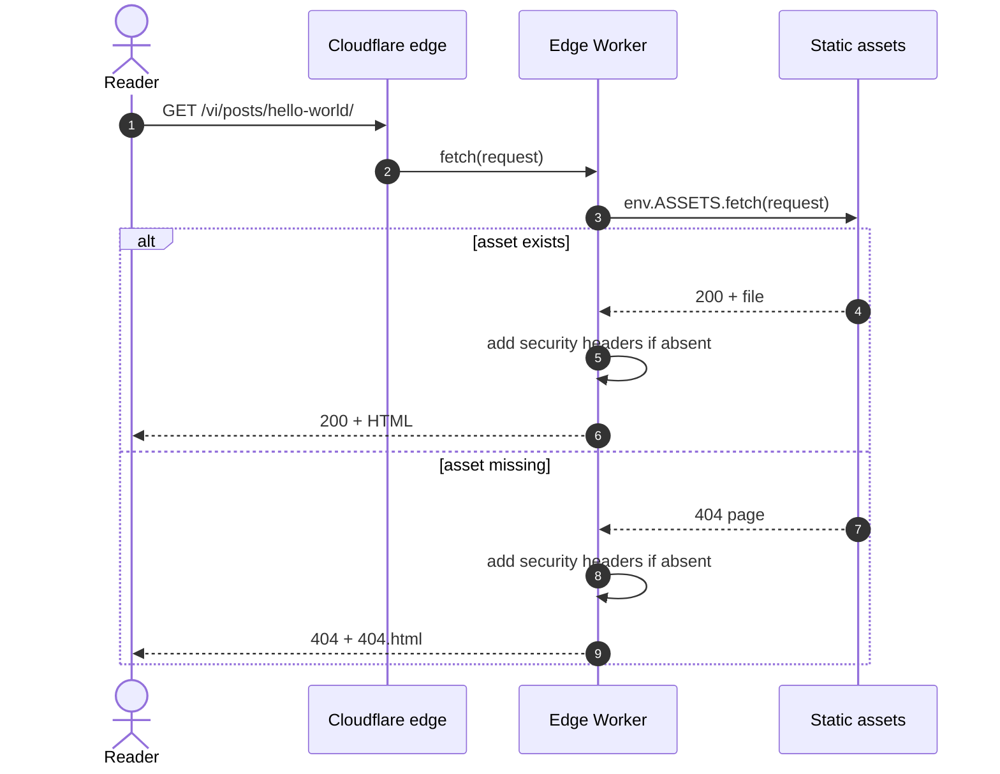

# Runtime Flows

## 1. Choosing flows

Only two flows matter: a reader requesting a file, and the 404 path when the file does not exist.

## 2. Flow — page or asset request

**Trigger / actor:** a reader requests any URL on the site.

### Steps

1. Cloudflare terminates TLS and invokes the Worker.
1. The Worker forwards the request to the asset binding.
1. The asset layer returns the pre-built file, or the configured 404 page for an unknown path.
1. The Worker adds `Strict-Transport-Security`, `X-Content-Type-Options`, `X-Frame-Options`,
   `Referrer-Policy`, and `Permissions-Policy` when the response does not already carry them, and preserves
   a null body for 204/205/304.
1. The response returns to the reader.

### Notable aspects

| Aspect               | Behaviour                                                                                   |
| -------------------- | ------------------------------------------------------------------------------------------- |
| Routing authority    | `assets` in `apps/edge/cloudflare.config.ts`; `notFoundHandling: "404-page"`                |
| Transaction boundary | None — no write exists                                                                      |
| Caching              | Assets are cached at Cloudflare's edge; the repository sets no cache policy                 |
| Header scope         | Headers apply to every response the Worker handles                                          |
| Failure mapping      | A missing file is a 404 page; a broken deploy is replaced by redeploying the previous build |

### Failure paths

- An unknown path returns the 404 page with status 404.
- A stale or partial deploy returns an older asset until the next deploy finishes; there is no partial state
  to repair.
- A Worker failure returns a platform error page; the fix is a redeploy, not a data repair.

## 3. Trust boundary

Every request is a read of a static file from the asset store. The only input is a URL; nothing is written
and no credential is read at runtime.

| Aspect         | Behaviour                                           |
| -------------- | --------------------------------------------------- |
| Trust boundary | Public internet; input is a URL only                |
| Data written   | None                                                |
| Secrets        | None at runtime; the deploy token exists only in CI |
| Fail-closed    | A failed build never reaches production             |

## 4. References

- Related chapters: [`02-container-view.md`](02-container-view.md), [`05-deployment-view.md`](05-deployment-view.md), [`08-crosscutting-concepts.md`](08-crosscutting-concepts.md).
- Feature: [`../features/content-pipeline.md`](../features/content-pipeline.md).
