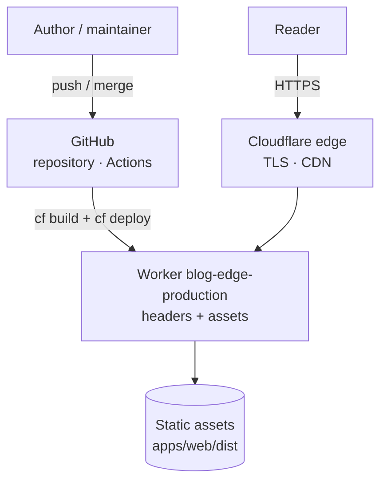

# Deployment View

## 1. Environments

| Environment | Purpose                 | Infrastructure source                                                           | Notes                                                   |
| ----------- | ----------------------- | ------------------------------------------------------------------------------- | ------------------------------------------------------- |
| Local       | Development, build, e2e | Astro dev server; `cf dev` for the asset Worker                                 | No credentials; the build is the artefact               |
| Preview     | Pre-production check    | `cf build` + `cf deploy --prebuilt --mode staging` to `blog-edge-staging`       | `workers.dev` origin; no custom domain                  |
| Production  | Live traffic            | `cf build` + `cf deploy --prebuilt --mode production` to `blog-edge-production` | Real domain; gated by the `production-edge` environment |

## 2. Deployment topology

## 3. Container to infrastructure mapping

| Element      | Infrastructure element                                 | Notes                                                              |
| ------------ | ------------------------------------------------------ | ------------------------------------------------------------------ |
| Static build | Worker asset binding, uploaded with the Worker version | `assetsDirectory: "../web/dist"` in `apps/edge/wrangler.config.ts` |
| Edge Worker  | Cloudflare Worker `blog-edge-<mode>`                   | `compatibilityDate: "2026-10-02"`, `nodejs_compat`                 |
| Domain       | `domains: [SITE_DOMAIN]` in the production config      | Claimed only when the mode is production and the variable is set   |

## 4. Infrastructure per environment

| Element | Local             | Preview                 | Production                |
| ------- | ----------------- | ----------------------- | ------------------------- |
| Site    | `astro dev` :4321 | Worker on `workers.dev` | Worker on the real domain |
| Assets  | `apps/web/dist`   | packaged in the Worker  | packaged in the Worker    |
| Secrets | none              | none                    | none at runtime           |
| Config  | shell env         | mode `staging`          | mode `production`         |

## 5. Scaling and availability

- **Scaling unit:** one Worker version per environment; assets are cached at the edge. Traffic scale is a
  platform concern, not an application one.
- **Statelessness:** nothing holds local state; a Worker replacement is invisible to readers beyond the
  deploy window.
- **Failure domains:** the Worker and assets share Cloudflare's edge. Losing the Worker means the site is
  down; there is no database to lose.
- **Degradation:** a missing search index degrades the search page; every other page is an independent file.
- **Rollback:** redeploy the previous commit's build. There is no schema and no data to restore.

## 6. What the repository ships versus the platform

- **Repository-owned:** the Astro build, the Worker bundle and asset manifest, the deploy workflow, and the
  domain/mode configuration.
- **Platform-owned:** the edge network and TLS, the asset store, Workers logs, DNS, and the deploy token
  store.

## 7. Deploying outside Cloudflare

Everything is static, so a VPS is straightforward: run `pnpm --filter @blog/web build` and serve
`apps/web/dist` with Nginx or Caddy, preserving the `/vi/`, `/en/`, feed, and sitemap paths. The Worker
exists only to add headers and serve assets; on a VPS the reverse proxy does both.

## 8. References

- Related chapters: [`02-container-view.md`](02-container-view.md), [`07-quality-requirements.md`](07-quality-requirements.md).
- Procedure: [`../operations/ci-cd-pipeline.md`](../operations/ci-cd-pipeline.md).
- Decision: [`../adr/0012-static-site-with-assets-only-worker.md`](../adr/0012-static-site-with-assets-only-worker.md).
