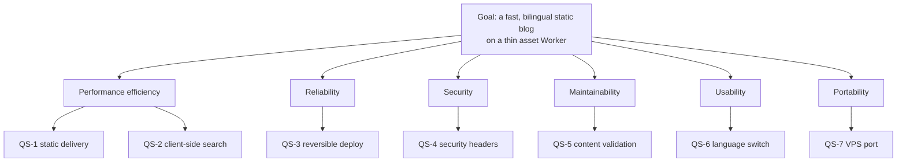

# Quality Requirements

The quality goals for a static blog are narrow: deliver the built files fast and intact, keep the build
honest about content, and make a bad deploy reversible. Each scenario cites evidence that exists today; an
unmet one is listed in [§3](#3-quality-requirements-not-yet-achieved).

## 1. Quality categories

| Category               | Requirement                                                                | Evidence                                                                       |
| ---------------------- | -------------------------------------------------------------------------- | ------------------------------------------------------------------------------ |
| Performance efficiency | A published page is a pre-built file; no request-time rendering            | `apps/web/astro.config.mjs` has no adapter; Lighthouse baseline 98 performance |
| Performance efficiency | Search runs against a pre-built index in the browser                       | `pagefind --site dist` in the web build                                        |
| Reliability            | A bad deploy is replaced by redeploying the previous commit                | Static assets only; no data to migrate                                         |
| Security               | Every Worker response carries transport and content-type hardening headers | `apps/edge/src/index.ts` `SECURITY_HEADERS`                                    |
| Security               | No runtime secret or PII exists                                            | No database and no request body; ADR-0012                                      |
| Maintainability        | Invalid post frontmatter fails the build                                   | Zod schema in `apps/web/src/content.config.ts`; `astro check` in CI            |
| Maintainability        | A change builds only the affected workspace                                | Turbo affected filter in `.github/workflows/ci.yml`                            |
| Usability              | A reader can switch language and stay on the same post                     | `translationKey` pairing; e2e assertion                                        |
| Portability            | The build output runs on any static host                                   | Plain `apps/web/dist`; no runtime dependency                                   |
| Deployability          | The production artefact is validated before upload                         | `cf deploy --prebuilt --mode production --dry-run`                             |

## 2. Quality scenarios

| ID   | Name                | Source      | Stimulus                                 | Environment | Artifact          | Response                                  | Response measure                                                               |
| ---- | ------------------- | ----------- | ---------------------------------------- | ----------- | ----------------- | ----------------------------------------- | ------------------------------------------------------------------------------ |
| QS-1 | Static delivery     | Reader      | Requests a published post                | Normal      | Worker + assets   | Returns the pre-built HTML                | Lighthouse performance 98 against the built `dist`                             |
| QS-2 | Client-side search  | Reader      | Types a query                            | Normal      | Pagefind index    | Shows matching posts with no network call | Query returns the expected post; e2e covers home → search → post               |
| QS-3 | Reversible deploy   | Maintainer  | Deploys a build that fails a smoke check | Production  | Previous build    | Redeploy the previous commit              | Site serves again within 10 minutes (drilled in Phase 4)                       |
| QS-4 | Security headers    | Reader      | Requests any page                        | Normal      | Worker            | Adds the five hardening headers           | `curl -sI` shows HSTS, nosniff, frame deny, referrer and permissions policy    |
| QS-5 | Content validation  | Author      | Commits a post with a missing `title`    | CI          | Content schema    | Build fails before deploy                 | Non-zero build; the post never appears in `dist`                               |
| QS-6 | Language switch     | Reader      | Switches locale on a translated post     | Normal      | Language switcher | Navigates to the paired translation       | Target H1 is the sibling title; e2e asserts `/en/posts/hello-world/` → `/vi/…` |
| QS-7 | VPS port            | Maintainer  | Serves `dist` from Nginx                 | Any host    | Static files      | Pages, feeds, sitemap resolve             | Same routes as production; no code change beyond header config                 |
| QS-8 | Fork-safe dry-run   | Contributor | Opens a PR touching `apps/web`           | CI          | Deploy workflow   | Validates the artefact without upload     | `cf deploy --prebuilt --mode production --dry-run` exits 0                     |
| QS-9 | Search index absent | Reader      | Opens search before the index is built   | Degraded    | SearchBox island  | Shows the unavailable label               | No page error; the rest of the site serves                                     |

## 3. Quality requirements not yet achieved

| ID              | Requirement                                                  | Why it is not yet achieved                                                                                 |
| --------------- | ------------------------------------------------------------ | ---------------------------------------------------------------------------------------------------------- |
| Headers         | A Content-Security-Policy is sent with every HTML response   | `SECURITY.md` F-22 accepts the gap; the policy belongs in `apps/web/public/_headers`, which does not exist |
| Discoverability | `robots.txt` and per-post Open Graph images exist            | `robots.txt` is missing; a post with a `cover` gets its own image, the rest fall back to `/og-default.png` |
| CI              | The browser suite runs on every pull request                 | Playwright is not invoked by any workflow                                                                  |
| Performance     | Performance and SEO budgets fail the build when they regress | Only a manual Lighthouse baseline is recorded                                                              |
| Reliability     | The 10-minute rollback has been measured                     | The drill is planned for Phase 4, not yet run                                                              |
| Operability     | An alert reaches a human when the site is down               | Uptime targets are documented, but the alert channel is undecided (`Q-4`)                                  |

## 4. References

- Related chapters: [`04-runtime-flows.md`](04-runtime-flows.md), [`05-deployment-view.md`](05-deployment-view.md), [`08-crosscutting-concepts.md`](08-crosscutting-concepts.md).
- Evidence: `SECURITY.md`, `.github/workflows/ci.yml`, `e2e/static-journeys.spec.ts`, [`../status.md`](../status.md).
- Standards: arc42 §10, ISO/IEC 25010.
