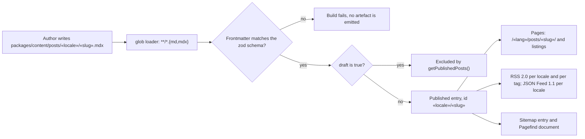

# Content Pipeline

## 1. What this is

One authored file becomes a page, a feed item, a sitemap entry, and a search document. The
pipeline is the `posts` content collection in `apps/web/src/content.config.ts` plus the helpers in
`apps/web/src/lib/`; the input is an MDX file in a locale folder under `packages/content/posts`.

| Field                      | Value                                                                                                                                      |
| -------------------------- | ------------------------------------------------------------------------------------------------------------------------------------------ |
| **Status**                 | shipped                                                                                                                                    |
| **Owner**                  | Repository maintainer — frontend (`apps/web`)                                                                                              |
| **Since**                  | Phase 3 (`T3.2`), pre-1.0                                                                                                                  |
| **Specification**          | none — reconstructed from the implementation                                                                                               |
| **Constraining decisions** | [ADR 0003](../adr/0003-astro-static-ssg-with-vue-islands.md), [ADR 0004](../adr/0004-bilingual-content-folder-per-locale.md)               |
| **Source**                 | `apps/web/src/content.config.ts`, `apps/web/src/lib/posts.ts`, `apps/web/src/lib/feeds.ts`, `apps/web/src/pages`, `packages/content/posts` |
| **Tests**                  | `e2e/static-journeys.spec.ts`                                                                                                              |

## 2. Why it exists

A note has to appear in several places at once: a listing, an article page, a tag page, two feed
formats, the sitemap, and the search index. Doing that by hand means each new note is an edit in
five files, and the five drift.

The pipeline makes the file the single input. The frontmatter schema is the data contract: a
malformed field fails the build instead of shipping a page with a missing title. Everything
downstream — ordering, translation pairing, feeds, tags — is derived from the same entry.

- **Before** — a new note meant a hand-written page with its own head tags, a hand-added feed item,
  a hand-maintained tag list, and no way to keep the Vietnamese and English versions pointing at
  each other.
- **After** — one file per locale produces every artefact, and an invalid one produces none: the
  build stops.
- **Not the goal** — there is no CMS, no scheduled publish, and no revision history beyond git.
  Drafts are a boolean, not a workflow.

## 3. How it behaves

Rules a reader can rely on, in the order they apply:

| Rule                                | Behaviour                                                                                                                 |
| ----------------------------------- | ------------------------------------------------------------------------------------------------------------------------- |
| Frontmatter is validated at build   | A missing `title`, an unknown `lang`, or a non-date `date` stops the build; there is no partial site with a degraded page |
| Drafts are filtered after loading   | `draft: true` is excluded by `getPublishedPosts()`, not by the schema, so a draft still has to satisfy every other field  |
| Ordering is newest first            | Every listing, and the feed item order, sorts by `date` descending                                                        |
| The slug is the id minus its folder | `vi/hello-world` is published at `/vi/posts/hello-world/`; the locale segment never appears twice in a URL                |
| A tag is derived, never declared    | Tags exist because some published post carries them; removing the last post with a tag removes the tag page and its feed  |
| Failed optional work degrades       | A cover missing from `public/` yields an enclosure of length `0` rather than a broken feed                                |

### 3.1 Authoring layout and identifiers

- **Folder per locale** — `packages/content/posts/{vi,en}/`, one `.mdx` file per slug; the glob loader is rooted at
  `../../packages/content/posts` relative to the app.
- **Entry id** — the path below that base, extension dropped: `vi/hello-world`. The id is what the
  collection stores and what `postSlug()` splits.
- **Route slug** — the id with its first segment removed, so the locale lives in the route prefix
  (`/[lang]/`) and not in the slug.
- **Extensions** — `.md` and `.mdx` are both loaded; MDX is what the feeds render to HTML.

Frontmatter is the whole contract (§4). Nothing else is configurable per post.

### 3.2 Selection, ordering, and translation pairing

`getPublishedPosts()` loads the collection, keeps entries whose `draft` is not `true`, and sorts by
`date` descending. `getPostsByLang()` narrows that to one locale. Nothing caches the result: each
page build calls the helper again.

Translations are paired by `translationKey`, a string shared by the variants of one post.
`getTranslations()` returns the published variants in `LOCALES` order, which is what the language
switcher and the `hreflang` alternates consume; `hasTranslation()` answers whether a published
variant exists in a given locale. The pairing is derived, so an unpaired post simply has no
counterpart to link to — it does not break the switcher.

### 3.3 Routes, feeds, and the sitemap

Every route is prerendered; there is no server render.

| Path                         | Kind                | What it contains                                                 |
| ---------------------------- | ------------------- | ---------------------------------------------------------------- |
| `/[lang]/`                   | page                | Site name, tagline, and every published post as a dated list     |
| `/[lang]/posts/`             | page                | Every published post for the locale                              |
| `/[lang]/posts/[...slug]/`   | page                | One article, with table of contents, prev/next and related posts |
| `/[lang]/tags/`              | page                | Tags with counts and a per-tag feed link                         |
| `/[lang]/tags/[tag]/`        | page                | Posts carrying the tag                                           |
| `/[lang]/about/`             | page                | Static copy from `apps/web/src/lib/pages-content.ts`             |
| `/[lang]/search/`            | page                | The Pagefind island in page mode                                 |
| `/[lang]/rss.xml`            | RSS 2.0             | Full-content feed for the locale                                 |
| `/[lang]/feed.json`          | JSON Feed 1.1       | The same items in JSON                                           |
| `/[lang]/tags/[tag]/rss.xml` | RSS 2.0             | Items carrying one tag                                           |
| `/rss.xml`, `/feed.json`     | RSS 2.0 / JSON Feed | Root aliases serving Vietnamese, the default locale              |

Feed bodies are built in `apps/web/src/lib/feeds.ts` and share one shape:

- **RSS** — items carry the full rendered HTML as `content:encoded`, `pubDate`, the author, one
  `category` element per tag, a permalink `guid`, and a cover `enclosure`; the channel sets
  `language`, a `ttl` of 60, `lastBuildDate`, and an `atom:link` with `rel="self"`.
- **JSON Feed** — version 1.1, with `summary`, `date_published`, `tags`, `language` and
  `content_html` per item; a cover adds both `image` and one `attachments` entry.
- **Enclosure size** — read from the file under `apps/web/public/` named by the frontmatter cover, with `fs.stat` at build time. A missing file
  leaves the size at `0` so the document stays well formed.
- **Sitemap** — emitted by `@astrojs/sitemap` with `defaultLocale: "vi"` and the `vi-VN` / `en-US`
  locale map, so each page carries its alternates.

### 3.4 Search index

Pagefind 1.5.2 runs as a postbuild step (`astro build && pagefind --site dist`) with no
configuration file. The index is split per language from `html[lang]`, which is `vi-VN` or `en-US`
on every page.

- **Indexed** — the element marked `data-pagefind-body`: the article element on a post, the page
  body on the index pages.
- **Excluded** — `data-pagefind-ignore` on the site header, the post meta line, tag chips, the
  related-posts section and the search chrome, so chrome text does not match a query.
- **Consumed** — `@blog/ui/SearchBox.vue` injects the Component UI bundle lazily on first use; the
  header variant opens it as a modal, the search page renders it inline.

## 4. Data it touches

There is no database in this feature: the collection is the file tree, read at build time and
discarded with the process.

| Entity / store             | Access | Columns this feature owns | Retention                                  |
| -------------------------- | ------ | ------------------------- | ------------------------------------------ |
| `posts` content collection | read   | every frontmatter field   | the file, until the commit that deletes it |
| `apps/web/public/covers/`  | read   | the cover binary          | as long as a post references it            |

Frontmatter fields:

| Field            | Type           | Required    | Effect                                                                |
| ---------------- | -------------- | ----------- | --------------------------------------------------------------------- |
| `title`          | string, min 1  | yes         | Listing, page heading, feed title, Open Graph title                   |
| `description`    | string, min 1  | yes         | Meta description, feed summary, JSON-LD description                   |
| `date`           | coerced `Date` | yes         | Sort order, `pubDate` / `date_published`, JSON-LD `datePublished`     |
| `tags`           | string array   | no, `[]`    | Tag pages, feed categories, JSON-LD `keywords`, related-post matching |
| `cover`          | string         | no          | Feed enclosure, JSON Feed `image` and `attachments`, Open Graph image |
| `draft`          | boolean        | no, `false` | Excluded from every artefact when true                                |
| `lang`           | `vi` or `en`   | yes         | Route prefix, feed language, `html[lang]`, `hreflang`, Pagefind index |
| `translationKey` | string, min 1  | yes         | Pairs variants; drives the language switcher and alternates           |

- **Ownership** — `apps/web` owns the schema and every reader of it; `packages/content` is data only.
- **Transactions** — none; a build either completes or emits nothing.
- **Caching** — none across builds; `posts.ts` creates one `AstroContainer` per process, which reuses
  the renderer, but each `postHtml` call still renders that post's MDX.
- **Migration** — no migration; the schema lives in `content.config.ts` and a field change is a
  build-breaking change to every post.

## 5. Interfaces it exposes

### 5.1 Served surface

The routes are listed in §3.3. Each is a static file in `apps/web/dist`; a request never reaches
an application server.

### 5.2 Internal surface

| Export                               | Kind     | Consumers                 | Purpose                                                        |
| ------------------------------------ | -------- | ------------------------- | -------------------------------------------------------------- |
| `getPublishedPosts`                  | function | pages, feeds              | Non-draft entries, newest first                                |
| `getPostsByLang`                     | function | pages, feeds, tags        | One locale's published entries                                 |
| `getTranslations` / `hasTranslation` | function | post page, layout         | Variants by `translationKey`, in locale order                  |
| `collectTags`                        | function | home, tag index, tag page | Unique tags across the given posts, sorted                     |
| `slugOf` / `postSlug`                | function | every route builder       | Route slug from an entry id                                    |
| `readingTimeOf`                      | function | post page                 | Whole minutes at 200 words per minute, never below 1           |
| `postHtml`                           | function | feeds                     | Rendered article HTML for `content:encoded` and `content_html` |
| `buildRssResponse` / `buildJsonFeed` | function | feed routes               | One feed document per locale or tag                            |

**Errors.** This feature produces no HTTP errors; its failure mode is a failed build, and the
build log names the entry and field that broke the schema.

## 6. Configuration

| Setting                 | Type         | Default                        | Required | Effect when absent                                                                              |
| ----------------------- | ------------ | ------------------------------ | -------- | ----------------------------------------------------------------------------------------------- |
| `PUBLIC_SITE_URL`       | absolute URL | `https://example.com`          | no       | Canonical, `hreflang`, feed and sitemap URLs keep the placeholder origin                        |
| `posts` loader `base`   | path         | `../../packages/content/posts` | —        | Fixed in `content.config.ts`; there is no environment override and no second source             |
| Pagefind postbuild step | CLI          | `pagefind --site dist`         | —        | No index is emitted, `/pagefind/` misses, and the search islands show their unavailable message |
| Sitemap locale map      | literal      | `vi` → `vi-VN`, `en` → `en-US` | —        | Alternates would be missing or mislabelled for every page                                       |

## 7. Edge cases and limitations

| Case                                                  | Behaviour                                                                                                             | Why it is this way                                                   |
| ----------------------------------------------------- | --------------------------------------------------------------------------------------------------------------------- | -------------------------------------------------------------------- |
| `lang` disagrees with the containing folder           | The route is built from `lang`, so the post is published under the other locale while its id keeps the folder segment | The schema types `lang` but does not cross-check it against the path |
| Two files in one locale share a `translationKey`      | Both publish; the switcher and alternates resolve to the first match per locale                                       | Pairing assumes one published variant per locale                     |
| A cover is named in frontmatter but missing from disk | The post page and feeds stay valid; the Open Graph image URL 404s                                                     | Feed generation prefers a well-formed document over a failed build   |
| A draft is the only post carrying a tag               | The tag page and its feed are not generated                                                                           | Tags are collected from published posts only                         |
| Every post is a draft                                 | Listings render the empty-state line; the tag index has no entries                                                    | Nothing special-cases an empty collection                            |

**Known limitations.**

- **No `robots.txt`** — `apps/web/public/` holds no robots file, so crawlers fall back to their own
  defaults. Adding one is a single static file.
- **The Open Graph image is either the post's cover or one site-wide default** — `public/og-default.png`
  is served for the home, About, tags, search and 404; nothing generates a card from a post title.
- **About copy is TypeScript** — `pages-content.ts` holds the bilingual copy. Identity and contact
  links come from `apps/web/src/lib/site.ts`; an empty contact value renders nothing. There is no
  `pages` collection.
- **Reading time over-counts Vietnamese** — whitespace tokenisation splits syllables, so a
  Vietnamese post reads slightly faster than reported. The badge tolerates it.

## 8. Observability and failure modes

| Signal                        | Kind      | What it tells the operator                                                              |
| ----------------------------- | --------- | --------------------------------------------------------------------------------------- |
| `astro build` exit status     | build log | Non-zero means invalid frontmatter or a broken render; the error names the entry        |
| Schema error naming the entry | build log | A named post and field violated the schema — the exact contract breach                  |
| `pagefind` summary line       | build log | Pages and words indexed; a sudden drop means `data-pagefind-body` moved or was removed  |
| `dist/pagefind/` presence     | artefact  | Absent means the postbuild step did not run, so search degrades to its unavailable text |

| Symptom                                | First signal                                           | Where to go                                                                                                          |
| -------------------------------------- | ------------------------------------------------------ | -------------------------------------------------------------------------------------------------------------------- |
| A post is missing from the site        | No URL exists for it in the build                      | Check `draft`, then `lang`, in the file itself                                                                       |
| The root aliases omit an English post  | `/rss.xml` and `/feed.json` list Vietnamese items only | The aliases serve the default locale by design; use `/[lang]/rss.xml` for English                                    |
| Search returns nothing on a new post   | Pagefind summary word count is low                     | Confirm the prose sits inside `data-pagefind-body`; see [`04-runtime-flows.md`](../architecture/04-runtime-flows.md) |
| A build fails after a frontmatter edit | Schema error naming the field                          | [`../development/local-setup.md`](../development/local-setup.md) for the build command                               |

## 9. References

- Specification: none — reconstructed from the implementation.
- Decisions: [`../adr/0003-astro-static-ssg-with-vue-islands.md`](../adr/0003-astro-static-ssg-with-vue-islands.md), [`../adr/0004-bilingual-content-folder-per-locale.md`](../adr/0004-bilingual-content-folder-per-locale.md).
- System views: [`../architecture/README.md`](../architecture/README.md), [`../architecture/04-runtime-flows.md`](../architecture/04-runtime-flows.md).
- Retirement of the runtime surfaces: [`../adr/0012-static-site-with-assets-only-worker.md`](../adr/0012-static-site-with-assets-only-worker.md).
