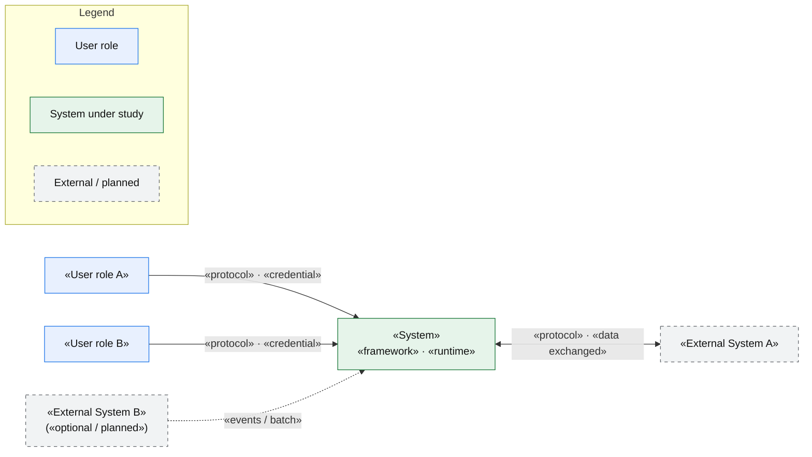

# Context and Scope

> **When to use:** you need to state where the system ends and everything else begins, before describing anything inside it.
>
> **What it answers:** who uses the system, which external systems it exchanges data with, which stakeholders care about it, and what is deliberately out of scope.
>
> Delete this blockquote when filled.

## 1. System context diagram

C4 Level 1: the system as a single box, its user roles, and the external systems it depends on. It shows no internals — those live in [`02-container-view.md`](02-container-view.md) and [`03-component-view.md`](03-component-view.md).

## 2. Stakeholders and concerns

An architecture description names each stakeholder and the concern the architecture must satisfy for them. The concern column states what the stakeholder needs answered, not what they want built.

| Stakeholder    | Concern    | How these docs address it   |
| -------------- | ---------- | --------------------------- |
| \<Stakeholder> | \<concern> | \<which chapter answers it> |
| \<Stakeholder> | \<concern> | \<which chapter answers it> |
| \<Stakeholder> | \<concern> | \<which chapter answers it> |

## 3. External partners and interfaces

One row per external system in the diagram: what it sends in, what it receives back, and over which protocol.

| Partner              | Inputs to \<System> | Outputs from \<System> | Protocol               |
| -------------------- | ------------------- | ---------------------- | ---------------------- |
| \<External System A> | \<data it sends>    | \<data it receives>    | \<protocol / contract> |
| \<External System B> | \<data it sends>    | \<data it receives>    | \<protocol / contract> |

**Interface ownership.** \<State which contract file owns each interface (for example an OpenAPI or AsyncAPI document) and which partner is authoritative for what.>

## 4. Scope

### In scope

- \<The surfaces, modules, and data this system owns.>

### Out of scope

- \<Neighbouring systems shown in the diagram that this description treats as context, not building blocks.>

## 5. C4 Level 1 guidance

Delete this section when filled.

- Show the system as exactly one box; every other box is a person, a user role, or an external system.
- Label each arrow with the protocol and the data or intent, never an internal endpoint path.
- Do not show databases, queues, or modules here; those appear at Level 2.
- A context diagram a non-engineer cannot read has failed its purpose.

## 6. References

- Related docs: [`02-container-view.md`](02-container-view.md), [`09-glossary.md`](09-glossary.md)
- Standards: C4.
