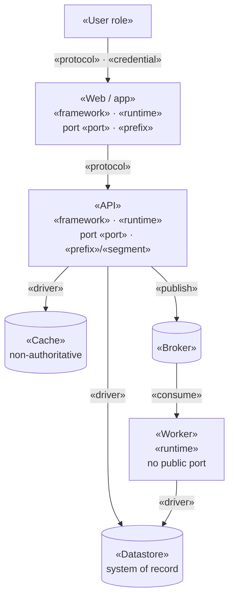

# Container View

> **When to use:** the system's boundary is settled and you now need to show the separately deployable processes inside it and the shared stores they use.
>
> **What it answers:** which containers exist, what each is responsible for, how they communicate, and which deployment unit each maps to.
>
> Delete this blockquote when filled.

## 1. Container diagram

C4 Level 2: each separately deployable process is one box. Arrows show **communication** (a call, a message, or shared access to a store) not a code dependency; two containers that never call each other can still share a library.

## 2. Container inventory

| Container    | Technology             | Responsibility     | Ports / endpoints  | Scaling unit                   |
| ------------ | ---------------------- | ------------------ | ------------------ | ------------------------------ |
| \<Web / app> | \<framework · runtime> | \<what it does>    | \<port · path>     | \<what scales>                 |
| \<API>       | \<framework · runtime> | \<what it does>    | \<port · path>     | \<what scales>                 |
| \<Worker>    | \<runtime>             | \<what it does>    | \<none / internal> | \<what scales>                 |
| \<Datastore> | \<engine>              | \<what it owns>    | \<port>            | \<managed / vertical>          |
| \<Cache>     | \<engine>              | \<what it caches>  | \<port>            | \<managed / non-authoritative> |
| \<Broker>    | \<engine>              | \<what it carries> | \<port>            | \<partitions / managed>        |

## 3. Containers to deployment units

| Container    | Deployment unit                          |
| ------------ | ---------------------------------------- |
| \<Container> | \<image / replica set / managed service> |
| \<Container> | \<image / replica set / managed service> |

**Source of truth.** \<State where the container list and the deployment units come from — build files, deployment manifests, or service configuration.>

## 4. C4 Level 2 guidance

Delete this section when filled.

- A container is separately deployable or separately runnable; a library or a class is not.
- Name the technology and the runtime on the box, not the team that owns it.
- A shared datastore is one box that several containers point at; do not duplicate it per consumer.
- Do not decompose a container's internals here — that is Level 3 in [`03-component-view.md`](03-component-view.md).

## 5. References

- Related docs: [`01-context-and-scope.md`](01-context-and-scope.md), [`03-component-view.md`](03-component-view.md), [`05-deployment-view.md`](05-deployment-view.md)
