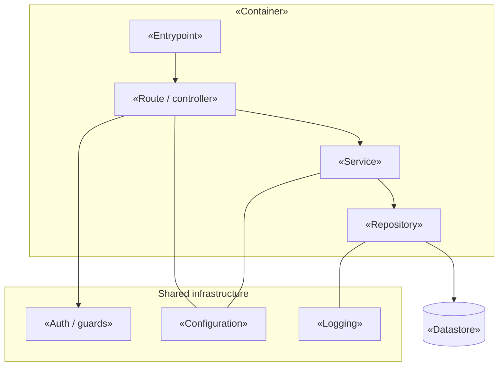

# Component View

> **When to use:** one container from [`02-container-view.md`](02-container-view.md) is load-bearing enough that its internals need their own description.
>
> **What it answers:** how that one container decomposes into components, what each component exposes, and which layering rules the code must respect.
>
> Delete this blockquote when filled.

## 1. Container under study

This chapter decomposes exactly one container: \<Container> from [`02-container-view.md`](02-container-view.md).

## 2. Component diagram

C4 Level 3: the components inside the chosen container. The house layering is controllers/routes → services → repositories, with shared infrastructure injected at the side.

## 3. Component inventory

| Component             | Responsibility  | Interface             | Depends on             |
| --------------------- | --------------- | --------------------- | ---------------------- |
| \<Entrypoint>         | \<what it does> | \<its public surface> | \<components it calls> |
| \<Route / controller> | \<what it does> | \<its public surface> | \<components it calls> |
| \<Service>            | \<what it does> | \<its public surface> | \<components it calls> |
| \<Repository>         | \<what it does> | \<its public surface> | \<components it calls> |

## 4. Layering rules

| Rule                                                | Enforcement           |
| --------------------------------------------------- | --------------------- |
| Controller → service → repository, never reversed   | \<how it is enforced> |
| A service never holds a database session            | \<how it is enforced> |
| Only the repository imports the data-access library | \<how it is enforced> |

**Invariant.** \<State the one boundary that must never be bypassed, in bold, and what breaks if it is.>

## 5. Deviations and known coupling

| Deviation                          | Why it exists | Task / decision  |
| ---------------------------------- | ------------- | ---------------- |
| \<component A reaches past B to C> | \<reason>     | \<ADR or ticket> |

## 6. C4 Level 3 guidance

Delete this section when filled.

- Decompose one container; a diagram that spans two containers is a Level 2 diagram.
- Every component box maps to something a developer can find in the code — a module, a package, or a class.
- Label the interface each component exposes, not its internals.
- Keep the coupling section short: draw only the edges a reader must know before changing a component.

## 7. Level 4 (code) is generated, not templated

C4 Level 4 is deliberately untemplated in this family. Class and object diagrams are generated from the code, not hand-maintained: run the documentation tooling against the package when a code-level view is needed. This chapter is the deepest hand-written level, and it stops at the component boundary.

## 8. References

- Related docs: [`02-container-view.md`](02-container-view.md), [`04-runtime-flows.md`](04-runtime-flows.md), [`08-crosscutting-concepts.md`](08-crosscutting-concepts.md)
