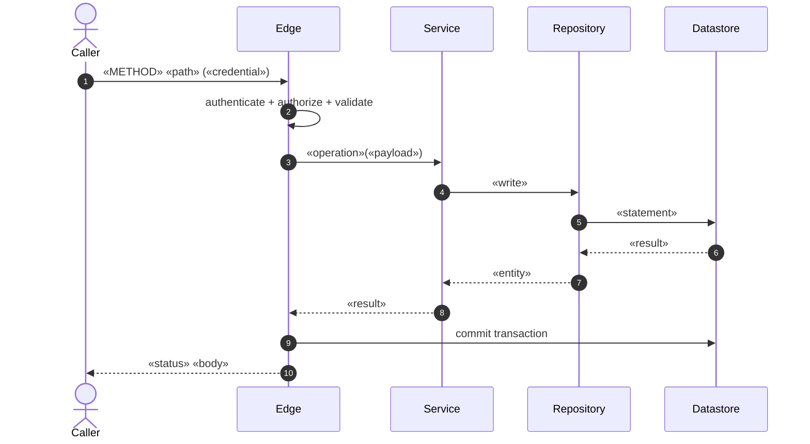
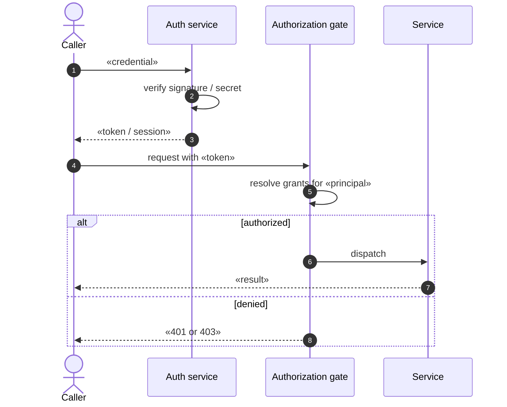
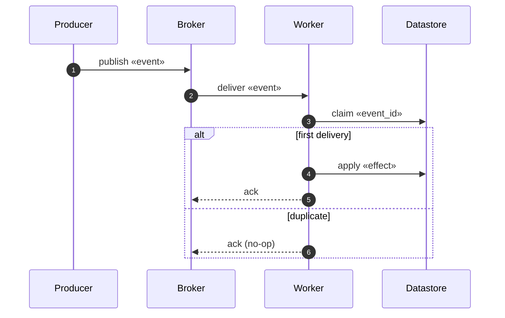

# Runtime Flows

> **When to use:** you need to show how parts of the system cooperate over time for a flow whose ordering, boundaries, or failure paths a reader cannot safely infer from the static views alone.
>
> **What it answers:** the participants, the ordering, the transaction and concurrency boundaries, and the failure paths of the architecturally relevant flows.
>
> Delete this blockquote when filled.

## 1. Choosing flows

Document a flow only when its **architectural relevance** is high: it crosses a boundary, opens or closes a transaction, takes a lock, must be idempotent, or has a failure path a reader would otherwise get wrong. Significance, not quantity, earns a flow — three load-bearing sequences beat thirteen CRUD traces. The three shapes below (synchronous request/response, authentication/authorization, and asynchronous/background) are the minimum a system usually needs.

## 2. Flow — synchronous request/response

**Trigger / actor:** \<caller> sends \<request>.

**Steps**

1. \<Edge component> authenticates \<caller> and validates the payload.
1. \<Service> applies \<business rule> and orchestrates the work.
1. \<Repository> persists \<entity> inside the unit of work.
1. The unit of work commits before the response is written.
1. \<Edge> serialises \<result> into the response body.

**Notable aspects**

| Aspect               | Behaviour                                            |
| -------------------- | ---------------------------------------------------- |
| Transaction boundary | \<where the unit of work opens and commits>          |
| Locking              | \<what is locked, if anything, and for how long>     |
| Idempotency          | \<the key or guard that makes a retry safe, or none> |
| Error mapping        | \<which exceptions map to which status>              |

**Failure paths**

- \<A precondition fails → status and body.>
- \<Persistence fails → the transaction rolls back and the error is mapped.>

## 3. Flow — authentication / authorization

**Trigger / actor:** \<caller> presents \<credential>.

**Steps**

1. \<Caller> presents \<credential> to \<auth component>.
1. \<Auth component> verifies the credential and mints \<token>.
1. \<Authorization gate> resolves the grants held by \<principal>.
1. The gate allows the request or rejects it; the service is only reached on allow.

**Notable aspects**

| Aspect         | Behaviour                                               |
| -------------- | ------------------------------------------------------- |
| Trust boundary | \<where an untrusted input becomes a trusted principal> |
| Token lifetime | \<TTL and rotation rule>                                |
| Fail-closed    | \<what happens when the verifier is unavailable>        |
| Error mapping  | \<the 401-versus-403 rule>                              |

**Failure paths**

- \<An expired or malformed credential → status.>
- \<An authenticated but unauthorized caller → status.>

## 4. Flow — asynchronous / background

**Trigger / actor:** \<producer> emits \<event>, or \<scheduler> fires \<job>.

**Steps**

1. \<Producer> emits \<event> to \<broker>.
1. \<Broker> delivers \<event> to \<worker>.
1. \<Worker> claims \<event_id> so a redelivery becomes a no-op.
1. On a first delivery \<worker> applies \<effect> and acknowledges; on a duplicate it acknowledges without side effects.

**Notable aspects**

| Aspect              | Behaviour                                          |
| ------------------- | -------------------------------------------------- |
| Delivery semantics  | \<at-least-once / at-most-once / exactly-once>     |
| Idempotency         | \<the key that makes a redelivery a no-op>         |
| Ordering            | \<the per-key ordering guarantee, if any>          |
| Retry / dead-letter | \<backoff policy and where terminal failures land> |

**Failure paths**

- \<Processing fails → retry with backoff, then dead-letter.>
- \<The broker is unavailable → backpressure, and fail-open or fail-closed.>

## 5. References

- Related docs: [`02-container-view.md`](02-container-view.md), [`03-component-view.md`](03-component-view.md), [`07-quality-requirements.md`](07-quality-requirements.md)
