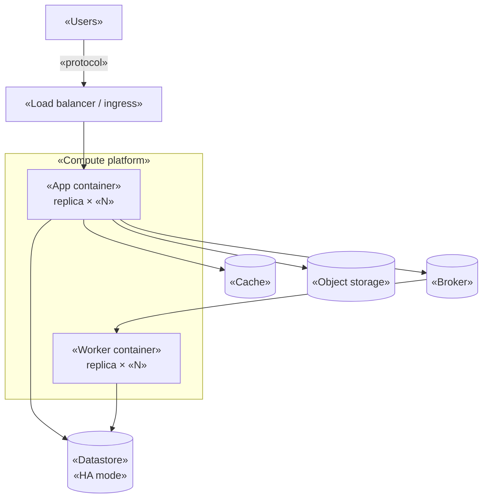

# Deployment View

> **When to use:** you need to say where the containers run, per environment, and what availability and scaling assumptions the topology makes.
>
> **What it answers:** the infrastructure nodes, the environments, how each container maps onto infrastructure, and what the repository ships versus what the platform provides.
>
> Delete this blockquote when filled.

## 1. Environments

| Environment   | Purpose                  | Infrastructure source       | Notes                |
| ------------- | ------------------------ | --------------------------- | -------------------- |
| \<local>      | \<developer machine>     | \<compose / dev containers> | \<what is simulated> |
| \<staging>    | \<pre-production checks> | \<orchestrator / platform>  | \<differences>       |
| \<production> | \<live traffic>          | \<orchestrator / platform>  | \<differences>       |

## 2. Deployment topology

## 3. Container to infrastructure mapping

| Container    | Infrastructure element    | Notes                     |
| ------------ | ------------------------- | ------------------------- |
| \<Container> | \<node / managed service> | \<replicas, statefulness> |
| \<Container> | \<node / managed service> | \<replicas, statefulness> |

## 4. Infrastructure per environment

| Element           | Local                     | Staging             | Production              |
| ----------------- | ------------------------- | ------------------- | ----------------------- |
| \<Datastore>      | \<local container>        | \<managed instance> | \<managed instance, HA> |
| \<Cache>          | \<local container>        | \<managed instance> | \<managed instance>     |
| \<Broker>         | \<local container>        | \<managed instance> | \<managed instance>     |
| \<Object storage> | \<local container / mock> | \<managed instance> | \<managed instance>     |

## 5. Scaling and availability

- **Scaling unit:** \<what is scaled, and on which signal.>
- **Statelessness:** \<which containers hold no local state and can scale horizontally.>
- **Failure domains:** \<which nodes share a failure domain, and what a single node loss costs.>
- **Degradation:** \<what still serves, and what fails, when the datastore, cache, or broker is unavailable.>

## 6. What the repository ships versus the target platform

Split every infrastructure element into two halves, and keep the split explicit:

- **Repository-owned:** the build artifacts and declarative manifests — images, compose files, and orchestrator manifests. An element on this side is built and shipped by the repository.
- **Platform-owned:** the provisioned infrastructure the manifests reference by role — \<load balancer>, \<network>, \<secrets backend>, and any \<managed service> the platform supplies. An element on this side is created and operated by the target platform.

The split is a rule, not a fixed fact; it follows the target platform. In a Compose-based target the \<Datastore> and \<Cache> are containers the project ships, so they are repository-owned; on a managed platform they are platform-owned, and the manifests only reference them by role. A reader editing this chapter must know which half they are changing.

## 7. References

- Related docs: [`02-container-view.md`](02-container-view.md), [`03-component-view.md`](03-component-view.md), [`06-data-architecture.md`](06-data-architecture.md)
