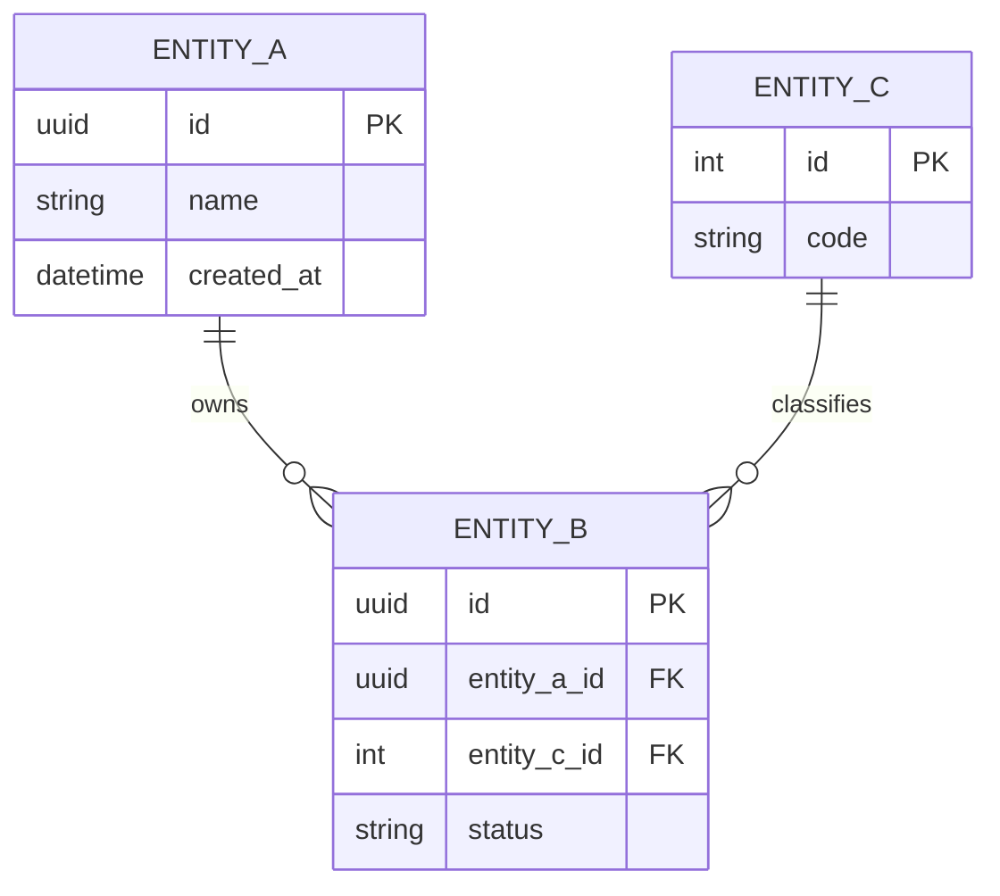

# Data Architecture

> **When to use:** the system persists state and a reader needs the entities, their ownership, and the rules that keep the store healthy.
>
> **What it answers:** the entities and their relations, who owns each, and how the data is indexed, partitioned, retained, cached, and migrated.
>
> Delete this blockquote when filled.

## 1. Entity-relationship diagram

## 2. Entities

| Entity      | Owner container | Key columns | Notes                     |
| ----------- | --------------- | ----------- | ------------------------- |
| \<Entity A> | \<container>    | \<columns>  | \<constraints, lifecycle> |
| \<Entity B> | \<container>    | \<columns>  | \<constraints, lifecycle> |
| \<Entity C> | \<container>    | \<columns>  | \<constraints, lifecycle> |

## 3. Indexing and conventions

| Convention   | Rule                                                |
| ------------ | --------------------------------------------------- |
| Naming       | \<the naming rule for tables, columns, and indexes> |
| Primary key  | \<the uuid-versus-bigint policy>                    |
| Foreign keys | \<constrained or logical-only, and why>             |
| Indexing     | \<what is indexed, and by which query pattern>      |

## 4. Partitioning and retention

| Entity    | Strategy                | Retention                                 |
| --------- | ----------------------- | ----------------------------------------- |
| \<Entity> | \<partition key / none> | \<how long data is kept, and by what job> |

## 5. Caching strategy

| Cached value | Owner        | TTL                    | Invalidation      |
| ------------ | ------------ | ---------------------- | ----------------- |
| \<value>     | \<container> | \<positive capped TTL> | \<what evicts it> |

**Cache rule.** \<State the rule that every cache write carries a positive, capped TTL, and what the system does when the cache is unavailable.>

## 6. Data ownership boundaries

- **\<Entity group>** is owned by \<container>; another container reads it only through \<interface>, never by writing its tables directly.
- **\<Shared store>** holds disjoint keyspaces: \<keyspace prefixes>.

## 7. References

- Related docs: [`02-container-view.md`](02-container-view.md), [`03-component-view.md`](03-component-view.md), [`08-crosscutting-concepts.md`](08-crosscutting-concepts.md)
