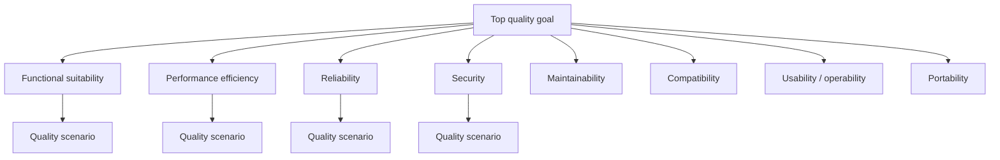

# Quality Requirements

> **When to use:** you are documenting the qualities this system is judged by and the measurable scenarios that decide whether each is met.
>
> **What it answers:** which qualities matter, what concrete stimulus exercises each, and how the response is measured.
>
> Delete this blockquote when filled.

The system's top-priority quality goals are stated once as goals; this chapter refines them into categories and measurable scenarios. A scenario is a requirement, not a description of the code — it says what must happen, not what currently does. The concepts the scenarios lean on are collected in [the crosscutting concepts chapter](08-crosscutting-concepts.md); the gaps that remain are listed in section 3.

## 1. Quality categories

Delete this note when filled. Categories follow ISO/IEC 25010 so a reader can check that nothing is missing. Each row shows the kind of requirement that belongs to it; write one row per coherent requirement in the format at the end of this section.

| Category                | What it covers                                                                                                                                        | Example requirement                                                  |
| ----------------------- | ----------------------------------------------------------------------------------------------------------------------------------------------------- | -------------------------------------------------------------------- |
| Functional suitability  | Completeness, correctness, and appropriateness of the functions provided                                                                              | `<the system performs X for Y>`                                      |
| Performance efficiency  | Time behaviour, resource use, and capacity                                                                                                            | `<p99 latency ≤ T at load L>`                                        |
| Reliability             | Faultlessness, availability, fault tolerance, and recoverability                                                                                      | `<survives failure F with RTO T and RPO R>`                          |
| Security                | Confidentiality, integrity, non-repudiation, accountability, and authenticity                                                                         | `<only principals holding G may perform A>`                          |
| Maintainability         | Modularity, reusability, analysability, modifiability, and testability                                                                                | `<a change of X touches at most N modules and is covered by test T>` |
| Compatibility           | Co-existence and interoperability with other systems                                                                                                  | `<interoperates with Z over protocol P>`                             |
| Usability / operability | Recognisability, learnability, operability, and user-error protection                                                                                 | `<an operator completes X in at most N steps>`                       |
| Portability             | Adaptability, installability, and replaceability across environments                                                                                  | `<runs on platform P with no code change>`                           |
| Safety and flexibility  | The ISO/IEC 25010:2023 revision adds safety and reframes usability as interaction capability; use the revision and terminology the project is held to | `<the system fails into state S on input I>`                         |

Delete this note when filled. The overview table is the sparse form; the scenario table below is the testable form. Write the overview as:

| Category                  | Requirement                                               | Evidence                                                 |
| ------------------------- | --------------------------------------------------------- | -------------------------------------------------------- |
| \<ISO/IEC 25010 category> | \<one coherent requirement, stated so it can be verified> | \<component, test, or decision record that evidences it> |

## 2. Quality scenarios

A quality scenario is a stimulus–response pair with a measurable outcome. The fields are fixed so two scenarios can be compared and so a test can be written from one.

| Field            | Meaning                                                                                              |
| ---------------- | ---------------------------------------------------------------------------------------------------- |
| ID               | Stable identifier, `QS-N`, never reused.                                                             |
| Name             | Short label for the scenario.                                                                        |
| Source           | The stakeholder, system, or clock that raises the stimulus.                                          |
| Stimulus         | The condition that arrives at the system.                                                            |
| Environment      | The state the system is in when the stimulus arrives — normal, peak, degraded, first run, and so on. |
| Artifact         | The part of the system that responds.                                                                |
| Response         | The behaviour the artifact exhibits.                                                                 |
| Response measure | The observable, measurable outcome that decides the requirement is met.                              |

| ID   | Name             | Source                           | Stimulus                  | Environment     | Artifact              | Response                 | Response measure                  |
| ---- | ---------------- | -------------------------------- | ------------------------- | --------------- | --------------------- | ------------------------ | --------------------------------- |
| QS-1 | \<scenario name> | \<stakeholder, system, or clock> | \<condition that arrives> | \<system state> | \<part that responds> | \<behaviour it exhibits> | \<observable, measurable outcome> |

Rules that keep the table honest:

- **A scenario must be measurable.** "Fast", "reliable", "user-friendly", and "high availability" are goals, not scenarios. A response measure is a number, a threshold, or an observation that can be checked, for example `<p99 latency ≤ 200 ms at 500 rps>` or `<zero duplicate rows per repeated submission>`.
- **State the environment.** The same response may be required under normal load and forbidden under degraded conditions; a scenario that omits the environment hides that.
- **The expected value comes from the requirement, not from the code.** Do not derive the response measure by running the implementation; derive it from the goal, the contract, or the decision that set it.
- **Evidence or a gap.** Every scenario cites the component, test, or decision record that shows it is met. A scenario that cannot be evidenced yet is marked as such and listed under the section below rather than presented as achieved.
- **Unimplemented requirements are marked explicitly.** Never silently drop a requirement because the system does not meet it. Mark it (for example by prefixing the response measure with `Not yet achieved:`) and give the tracking item.

## 3. Quality requirements not yet achieved

A requirement the system does not yet meet stays in the register, marked, with the reason it is unmet and the item that tracks it.

| ID      | Requirement        | Why it is not yet achieved |
| ------- | ------------------ | -------------------------- |
| \<QS-N> | \<the requirement> | \<the gap>                 |

## 4. References

- Related docs: [`04-runtime-flows.md`](04-runtime-flows.md), [`08-crosscutting-concepts.md`](08-crosscutting-concepts.md)
- Standards: the arc42 structure (part 10, quality requirements).
