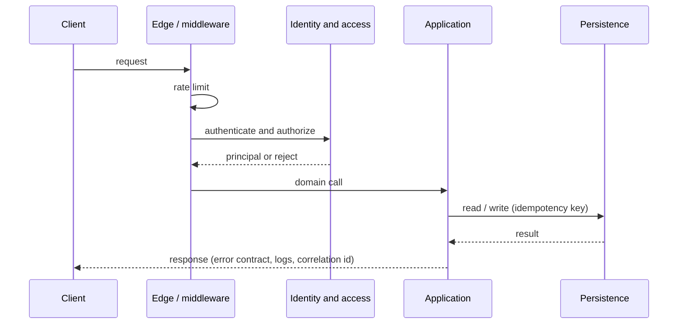

# Crosscutting Concepts

> **When to use:** you are capturing the decisions that apply across many building blocks rather than belonging to one of them.
>
> **What it answers:** for each concept, what it is, where it lives, and the rule every implementation must hold; keep only the concepts this system actually needs and delete the rest.
>
> Delete this blockquote when filled.

A concept is crosscutting when no single building block owns it: it constrains several blocks at once and is easy to implement inconsistently. Cover only the ones that matter here — an empty concept row is worse than an absent one, because it hides the fact that the concern was never decided. The building blocks that instantiate these concepts are in [the component view](03-component-view.md); their run-time behaviour is in [the runtime flows](04-runtime-flows.md); the topology the concepts run on is in [the deployment view](05-deployment-view.md).

## 1. Concepts

Delete this note when filled. Each row below is a placeholder: replace the concept name with the real one, or delete the whole row if the system does not have that concern. State every concept as a rule a reviewer can check, not just as a description of the current code.

| Concept                                               | What it is                                                                                          | Where it lives                                             | The rule                                                                                                       |
| ----------------------------------------------------- | --------------------------------------------------------------------------------------------------- | ---------------------------------------------------------- | -------------------------------------------------------------------------------------------------------------- |
| \<Concept 1> — Identity and access                    | \<authentication and authorization: how a caller proves who it is and what it may do>               | \<module, component, or path>                              | \<the invariant every protected operation must hold>                                                           |
| \<Concept 2> — Error handling and the error contract  | \<one normalised failure envelope, its fields, and the mapping from every failure source to it>     | \<module, component, or handler>                           | \<no failure reaches a caller in an ad-hoc shape>                                                              |
| \<Concept 3> — Persistence and transactions           | \<the data access model, the unit of work, and who owns the commit boundary>                        | \<repository layer and session provider>                   | \<database access stays inside the repository layer; the transaction boundary is explicit>                     |
| \<Concept 4> — Caching                                | \<which reads are cached, in which store, and how entries are invalidated>                          | \<cache provider and its callers>                          | \<every write carries a positive, capped time to live; invalidation is targeted, never a full flush>           |
| \<Concept 5> — Rate limiting                          | \<the request cap, its granularity, its storage, and its behaviour when the limiter is unavailable> | \<middleware or gateway>                                   | \<the failure mode is chosen deliberately: fail open or fail closed, never by accident>                        |
| \<Concept 6> — Idempotency and concurrency control    | \<how repeated or concurrent requests are made to have one effect>                                  | \<key store, unique constraint, or lock>                   | \<a retried or duplicated request never applies its effect twice>                                              |
| \<Concept 7> — Logging and observability              | \<what is logged, in what format, at what level, and how records are correlated across components>  | \<logging factory and instrumentation>                     | \<secrets and personal data never reach a log line; every record carries a correlation identifier>             |
| \<Concept 8> — Configuration                          | \<how settings are grouped, loaded, validated, and scoped to a component>                           | \<settings groups and their composites>                    | \<required secrets fail closed on a missing or empty value; a component reads only the configuration it needs> |
| \<Concept 9> — Scheduling                             | \<the recurring work, its schedule, and its single-fire guarantee>                                  | \<scheduler and job definitions>                           | \<a job body is safe to run in every worker and takes its own lock when it must fire once>                     |
| \<Concept 10> — Wire and API conventions              | \<the shape of the external contract: field naming, request strictness, and response tolerance>     | \<shared schema base classes and the generated contract>   | \<the wire format is consistent across every surface and undeclared input is rejected>                         |
| \<Concept 11> — Localisation and internationalisation | \<how language, locale, and translated content are modelled and selected for a response>            | \<translation store and the request's language resolution> | \<no user-visible string is hard-coded in one language>                                                        |

## 2. References

- Related docs: [`03-component-view.md`](03-component-view.md), [`04-runtime-flows.md`](04-runtime-flows.md), [`05-deployment-view.md`](05-deployment-view.md), [`09-glossary.md`](09-glossary.md)
- Authorities: [`error-codes`](../api/error-codes.md) — the error-code catalogue; the project's [`coding-rules`](../development/coding-rules/) folder.
- Conventions: [`CONVENTIONS`](../CONVENTIONS.md)
