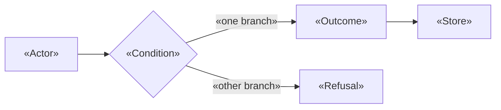
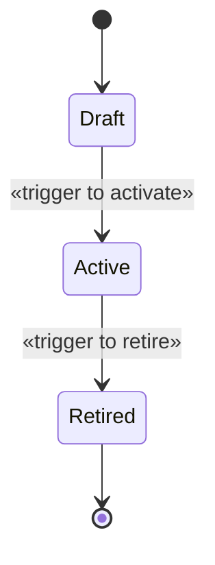

# Feature — \<Feature Name>

> **When to use:** a feature has shipped and someone other than its author now has to change it, operate it, or explain it.
>
> **What it answers:** what this feature is, why it exists, how it behaves, which data and interfaces it owns, how it is configured, which edge cases bite, and what has changed since it shipped.
>
> Delete this blockquote when filled.

## 1. What this is

\<One paragraph in plain language: what a user or caller can now do that they could not before. History belongs in §9 and rationale in the ADRs this document links; a maintainer reads this paragraph to know what they are looking at.>

| Field                      | Value                                                            |
| -------------------------- | ---------------------------------------------------------------- |
| **Status**                 | \<in design / in development / shipped / deprecated>             |
| **Owner**                  | \<the team or role that answers for this feature>                |
| **Since**                  | \<release or date it first shipped>                              |
| **Specification**          | \<link to the requirements spec beside this document, or "none"> |
| **Constraining decisions** | \<links to the ADRs this feature obeys>                          |
| **Source**                 | `<path/to/the/feature>`                                          |
| **Tests**                  | `<path/to/tests>`                                                |

## 2. Why it exists

\<The problem this feature answers, who has it, and what they did before it existed. Two or three short paragraphs at most. Do not restate a decision: where the shape is the result of a recorded decision, link the [ADR](../adr/README.md) and say only which constraint it imposed.>

- **Before** — \<what the caller or operator had to do instead, and what it cost>.
- **After** — \<what the feature replaces, and the improvement a reader can check>.
- **Not the goal** — \<the adjacent problem this feature deliberately does not solve, and who owns it>.

## 3. How it behaves

\<The observable contract, in the order a caller meets it: what triggers the feature, what it does, what it produces. Lead with the diagram when the behaviour branches; delete the diagram when the behaviour is a straight line.>

Rules a caller can rely on, in the order they apply:

| Rule                            | Behaviour                                      |
| ------------------------------- | ---------------------------------------------- |
| \<the rule a caller depends on> | \<what always happens, and what never happens> |

### 3.1 States

\<A feature with an explicit state machine fills the table and the diagram below; one with no states keeps this subsection to a single line ("No explicit state machine; `<Flag>` is a freely settable status.") so the subsection and the numbering stay stable.>

| State     | Meaning                                         | Set by               |
| --------- | ----------------------------------------------- | -------------------- |
| `<STATE>` | \<what holding this state means for the caller> | \<operation or role> |

## 4. Data it touches

| Entity / store | Access              | Columns this feature owns                   | Retention                                            |
| -------------- | ------------------- | ------------------------------------------- | ---------------------------------------------------- |
| `<table_name>` | read / write / both | \<columns, or "none — reads the row whole"> | \<how long the rows live, and which job prunes them> |

- **Ownership** — \<the module that owns each table, and whether this feature writes it directly or only through that owner's interface>.
- **Transactions** — \<the boundary one call runs in, and what is atomic>.
- **Caching** — \<cache key, the positive capped TTL, and what invalidates it on a write>.
- **Migration** — \<the migration that introduced this storage, and whether it is reversible>.

## 5. Interfaces it exposes

### 5.1 HTTP surface

| Method     | Path      | Caller                      | Permission             | Notes                                  |
| ---------- | --------- | --------------------------- | ---------------------- | -------------------------------------- |
| `<METHOD>` | `/<path>` | \<client / admin / service> | \<permission or scope> | \<idempotency, pagination, rate limit> |

### 5.2 Events and messages

| Direction            | Channel / subject | Payload                                           | Guarantee                                 |
| -------------------- | ----------------- | ------------------------------------------------- | ----------------------------------------- |
| publishes / consumes | `<channel>`       | \<schema name and the contract file that owns it> | \<at-least-once, ordering, deduplication> |

### 5.3 Internal and operator surface

| Export                 | Kind                            | Consumers                   | Purpose                             |
| ---------------------- | ------------------------------- | --------------------------- | ----------------------------------- |
| `<service / function>` | \<class, protocol, or DI token> | \<the modules that call it> | \<what it guarantees to them>       |
| `<command>`            | CLI                             | \<the operator who runs it> | \<what it does, and when to run it> |

**Errors.** This feature raises the codes \<codes this feature returns>, each defined once in [`error-codes`](../api/error-codes.md), in the envelope that catalogue defines. Do not restate a code's status here.

## 6. Configuration

| Setting          | Type    | Default     | Required / secret          | Effect when absent                           |
| ---------------- | ------- | ----------- | -------------------------- | -------------------------------------------- |
| `<SETTING_NAME>` | \<type> | `<default>` | \<yes / no; secret or not> | \<fail closed at startup, or fall back to X> |

## 7. Edge cases and limitations

| Case                                         | Behaviour       | Why it is this way                                              |
| -------------------------------------------- | --------------- | --------------------------------------------------------------- |
| \<an input or state that surprises a caller> | \<what happens> | \<the constraint behind it, or the ticket that would change it> |

**Known limitations.** \<what the feature deliberately does not do, and the event that would revisit it>.

## 8. Observability and failure modes

| Signal                        | Kind                             | What it tells the operator                                   |
| ----------------------------- | -------------------------------- | ------------------------------------------------------------ |
| `<log event / metric / span>` | \<log, counter, histogram, span> | \<what a healthy value looks like, and what a bad one means> |

| Symptom               | First signal                             | Where to go                                                                     |
| --------------------- | ---------------------------------------- | ------------------------------------------------------------------------------- |
| \<observable failure> | \<log line, metric, or alert that fires> | \<link into the runbook family, [`runbooks`](../operations/runbooks/README.md)> |

## 9. Change log

Newest first. Each row names the behaviour that changed, not the file that was edited.

| Date          | Change                                                                                    | Recorded by                    |
| ------------- | ----------------------------------------------------------------------------------------- | ------------------------------ |
| \<YYYY-MM-DD> | \<the behaviour, data, interface, or configuration change, and the release it shipped in> | \<ADR, ticket, or change link> |

## 10. How to keep this document true

Delete this section when filled.

- Edit this document in the same change as the code it describes ([`CONVENTIONS`](../CONVENTIONS.md) §9); a behaviour change with a stale document is an incomplete change.
- When a behaviour changes, update the flow in §3, the affected row in §7, the signal in §8, and then add a row to §9 — in that order.
- Link decisions, never restate them: an ADR or an architecture chapter is the authority for why the shape is what it is ([`CONVENTIONS`](../CONVENTIONS.md) §12). A change-log row says what changed; the link says why.
- When the feature is removed, delete this document in the change that removes the code; there is no deprecated archive.

## 11. References

- Specification: \<link to the requirements spec beside this document, or "none">.
- Decisions: \<links into [`adr`](../adr/README.md)>.
- System views: \<links into [`architecture`](../architecture/README.md)>.
- Error codes: [`error-codes`](../api/error-codes.md).
- Related features: \<links to the neighbouring documents under `docs/features/`>.
