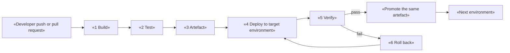

# CI/CD Pipeline

> **When to use:** the system has a repository and needs its delivery path stated — what runs when a change lands, what blocks it, which artefact reaches an environment, and how a bad release is undone.
>
> **What it answers:** the stages from commit to production with their triggers, gates, and outputs; how a build is promoted, versioned, tagged, and rolled back; and where pipeline secrets live.
>
> Delete this blockquote when filled.

The pipeline is the only supported path from a merged commit to a running environment. It is versioned with the code it ships, it builds one artefact per commit and promotes that same artefact, and every stage either blocks a change or is explicitly advisory. Naming, formatting, and commit conventions are not restated here — they have one home in the project's [`coding-rules`](../development/coding-rules/) folder.



## 1. Pipeline model

| Property          | Rule                                                                                                        |
| ----------------- | ----------------------------------------------------------------------------------------------------------- |
| Artefact identity | One image and manifest per commit; every environment runs the digest built once in stage 3, never a rebuild |
| Reproducibility   | A stage is reproducible from the commit plus the pipeline configuration committed to the repository         |
| Blocking gate     | A stage that cannot fail a change is not a gate; §2 says for each stage whether it blocks or is advisory    |
| Advisory check    | A non-blocking check reports on the change but never holds a merge or a deploy                              |
| Configuration     | Pipeline configuration is a reviewed file in the repository, not settings clicked into a provider's UI      |
| Credentials       | The pipeline holds references to secrets, never secret values — see §6                                      |
| Auditability      | Every deploy records commit, artefact digest, operator or automation, environment, and timestamp            |

## 2. Stages

### 2.1 Build

| Field   | Value                                                                               |
| ------- | ----------------------------------------------------------------------------------- |
| Trigger | \<e.g. a pull request opened or updated, and a push to a protected branch>          |
| Runs    | \<e.g. dependency install from a lockfile, lint, format check, type check, compile> |
| Gate    | Blocking — a failure stops the change here and no later stage runs                  |
| Outputs | \<e.g. warm dependency caches, compiled packages consumed by the test stage>        |

```bash
uv sync --frozen
uv run ruff check src
uv run ruff format --check src
```

### 2.2 Test

| Field   | Value                                                                                                |
| ------- | ---------------------------------------------------------------------------------------------------- |
| Trigger | The same change, once Build succeeds                                                                 |
| Runs    | \<e.g. unit tests, integration tests against ephemeral dependencies, contract tests, coverage floor> |
| Gate    | Blocking — the coverage floor and every failing test stop the change                                 |
| Outputs | \<e.g. test report, coverage artefact attached to the change>                                        |

```bash
uv run pytest -q --tb=short
uv run pytest tests/contract -q
```

### 2.3 Artefact

| Field   | Value                                                                                               |
| ------- | --------------------------------------------------------------------------------------------------- |
| Trigger | Merge to the mainline, or a version tag (§4)                                                        |
| Runs    | \<e.g. build the runtime image, scan dependencies and the image, sign, produce a manifest and SBOM> |
| Gate    | Blocking — an artefact with a failing scan or a missing signature must not publish                  |
| Outputs | \<immutable image addressable by digest, plus its manifest and SBOM>                                |

```bash
docker build --build-arg "VERSION=$VERSION" -t "$IMAGE:$VERSION" .
docker push "$IMAGE:$VERSION"
```

### 2.4 Deploy

| Field   | Value                                                                                                                                 |
| ------- | ------------------------------------------------------------------------------------------------------------------------------------- |
| Trigger | A promotion into an environment (§3)                                                                                                  |
| Runs    | \<e.g. run pending schema migrations as their own step, then roll the existing deployment to the new digest, then wait for readiness> |
| Gate    | Blocking in lower environments; \<manual approval by a named role> before production                                                  |
| Outputs | Deployment record, revision history, and the environment's observed state                                                             |

```bash
kubectl -n "$NAMESPACE" set image "deployment/$APP" "app=$IMAGE@$DIGEST"
kubectl -n "$NAMESPACE" rollout status "deployment/$APP" --timeout=5m
```

### 2.5 Verify

| Field   | Value                                                                                                                                                                 |
| ------- | --------------------------------------------------------------------------------------------------------------------------------------------------------------------- |
| Trigger | Immediately after a deploy completes                                                                                                                                  |
| Runs    | \<e.g. health and readiness probes, a smoke suite over the critical journeys, a short watch of the signals in [`monitoring-and-alerts.md`](monitoring-and-alerts.md)> |
| Gate    | Blocking — a failed verification triggers stage 6 rather than leaving the revision serving traffic                                                                    |
| Outputs | Verification result attached to the deployment record                                                                                                                 |

```bash
curl -fsS "$BASE_URL/healthz" | jq -e '.status == "ok"'
```

### 2.6 Rollback

| Field   | Value                                                               |
| ------- | ------------------------------------------------------------------- |
| Trigger | A failed verification, or a human decision under §5                 |
| Runs    | Redeploy the previous known-good digest, or roll the change forward |
| Gate    | Advisory — this is a recovery action, not a quality gate            |
| Outputs | Previous revision serving traffic again, plus an incident record    |

```bash
kubectl -n "$NAMESPACE" rollout undo "deployment/$APP"
kubectl -n "$NAMESPACE" rollout status "deployment/$APP" --timeout=5m
```

## 3. Environment promotion

| Environment    | Reached by                             | Gate before promotion                                  | Data                           | Rollback target                 |
| -------------- | -------------------------------------- | ------------------------------------------------------ | ------------------------------ | ------------------------------- |
| \<Development> | \<automatic on merge>                  | \<build and test stages green>                         | \<synthetic data>              | \<previous commit's artefact>   |
| \<Staging>     | \<automatic, or a one-click promotion> | \<staging smoke suite green>                           | \<masked production-like data> | \<previous promoted artefact>   |
| \<Production>  | \<promotion approved by \<role>>       | \<staging held for \<e.g. 24 hours> with no new alert> | \<live data>                   | \<previous production artefact> |

- The same digest moves through every environment; only configuration and data differ.
- A promotion is a decision with an owner, recorded on the deployment record (§1); the approver may refuse it.
- Schema migrations run before the new revision serves traffic and must stay compatible with the previous revision, so a rollback remains possible.
- Production is never reached directly by a branch build.

## 4. Versioning and tagging

| Artefact          | Version source                                                       | Immutable?   | Notes                                                                     |
| ----------------- | -------------------------------------------------------------------- | ------------ | ------------------------------------------------------------------------- |
| Application image | Tag `v<version>` on the release commit                               | Yes          | The digest is pinned in every environment                                 |
| API contract      | Version in the path, header, or contract file under [`api`](../api/) | Per contract | A breaking change ships a new version, never a silent edit to the old one |
| Database schema   | Ordered migrations committed to the repository                       | Yes          | An applied migration is never edited; a correction is a new migration     |
| Documentation     | Commit on the same change as the code                                | n/a          | Docs ship with the behaviour they describe                                |

- The version comes from the tag and is never hand-edited into a file: a mismatch between tag and reported version is a release defect.
- Prerelease tags such as `v<version>-rc.<n>` never reach production; a hotfix branches from the released commit and produces a new patch version.
- A published tag and its artefact are immutable: a defect is fixed by publishing a new version, never by overwriting one.

## 5. Rollback

Two mechanisms; choose one before touching production and say which in the incident channel.

| Mechanism    | When it applies                                                             | Cost                                                                 |
| ------------ | --------------------------------------------------------------------------- | -------------------------------------------------------------------- |
| Roll back    | The previous artefact still runs against the current schema and data        | Version divergence, and the fix still has to be delivered afterwards |
| Roll forward | The change is bound to a schema or data migration that cannot run backwards | Slower, and it demands a correct fix under pressure                  |

1. Declare the rollback target and the reason, and name the person performing it.
1. Stop the deploy and promotion pipeline so nothing overwrites the target revision while it is being restored.
1. Redeploy the previous digest: \<rollback command for the platform>.
1. Verify with the same checks as stage 5 — an unverified rollback has not happened.
1. Record the target version, the time, and the trigger, and open the follow-up issue.
1. Restore the producers and consumers the change affected — queues, scheduled jobs, or downstream contracts.

Blast radius: a revision that already applied a migration may have left data in the new shape. State the actual state of the data before running step 3.

## 6. Secrets in pipeline configuration

- **Never** place a secret value in the repository, in pipeline configuration, in an artefact, or in a log line. Configuration carries a reference (a secret-store path, a vault key, or a workload identity role) resolved at stage time.
- Each stage receives only the secrets it needs; a test stage never holds production credentials.
- Job credentials are short-lived and issued per run through workload identity or a token exchange, not a static long-lived key.
- A secret reaches a process through an environment variable or a mounted file, never a command-line argument another process can read.
- The runner masks referenced values in logs; masking is a safety net, not the control, because anything a stage echoes can still leak.
- Rotation happens in the secret store without editing a pipeline file. A leaked secret is rotated first and the log purged second.

| Secret reference           | Consumer stage | Store path           | Rotation owner  | Rotation cadence                               |
| -------------------------- | -------------- | -------------------- | --------------- | ---------------------------------------------- |
| \<registry credential>     | 3 Artefact     | \<secret-store path> | \<team or role> | \<e.g. every 90 days>                          |
| \<deploy credential>       | 4 Deploy       | \<secret-store path> | \<team or role> | \<e.g. per run, via workload identity>         |
| \<production database URL> | 4 Deploy       | \<secret-store path> | \<team or role> | \<e.g. on staff change and on rotation policy> |

## 7. References

- Conventions: [`CONVENTIONS`](../CONVENTIONS.md) — naming, formatting, and placeholder rules for this template and every document filled from it.
- Code and commit conventions: the project's [`coding-rules`](../development/coding-rules/) folder — the single authority; this page does not restate it.
- Signals behind stage 5 and the deploy watch: [`monitoring-and-alerts.md`](monitoring-and-alerts.md).
- Recovering an environment after a failed deploy: [`disaster-recovery.md`](disaster-recovery.md).
- Incident procedures: [`runbooks`](runbooks/README.md).
- The scaffold this template fills: [`README`](../README.md).
